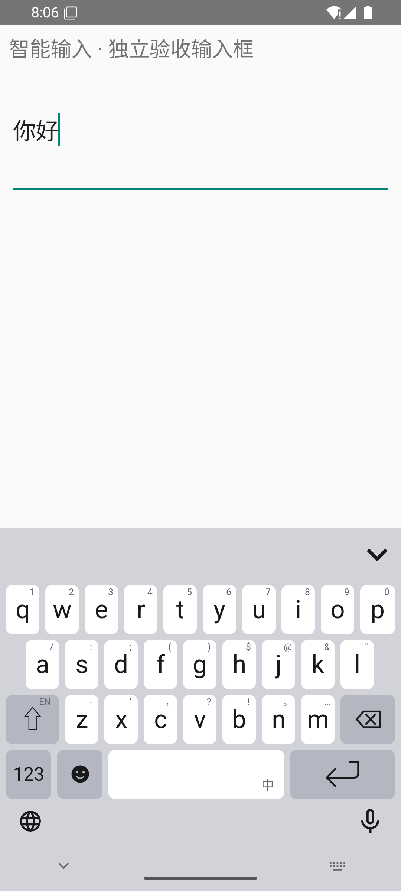
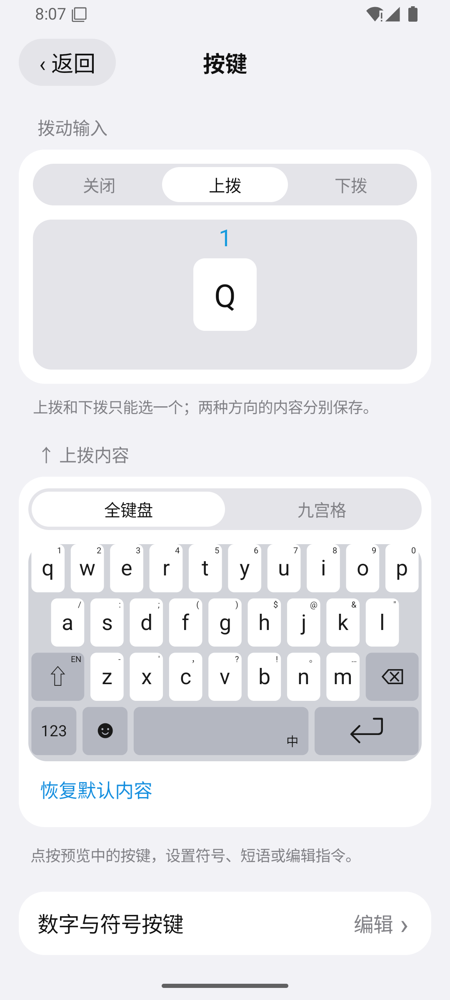
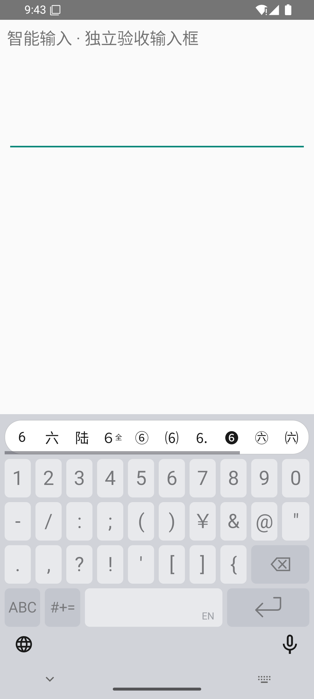

# RimeAndroid · 同文输入法增强版

一款基于 [同文输入法 Trime](https://github.com/osfans/trime) 改进的 Android 中文输入法。它保留 Rime 的输入能力，补充更直观的按键设置、数字长按、符号与表情面板，以及剪贴板编辑工具。

界面和部分交互参考 [ReRime](https://github.com/ReRime-IME)。本项目是独立的 Android 定制项目，与 ReRime 官方没有隶属关系。代码、词库和其他资源的具体出处见 [来源与许可](THIRD_PARTY.md)。

**当前源码：2.30，基于 Trime 3.3.13。** 目前提供源码，尚未发布本仓库的可下载安装包。仓库不包含个人词库、聊天内容、手机备份或签名私钥。

## 看看界面

| 主键盘 | 按键设置 | 数字长按 |
| :---: | :---: | :---: |
|  |  |  |

以上是真实模拟器截图。主键盘、按键设置取自 2.28，数字长按取自 2.30；只使用空输入框或公开测试文字。截图展示了参考主题，首次安装后需在主题设置中选择它。

## 可以做什么

- **按自己的习惯设置按键**：选择上拨或下拨，为按键设置符号、短语或编辑动作，并在预览中查看。
- **长按数字选其他写法**：例如长按 `6`，可以选 `六`、`陆`、`６`、`⑥` 等；横滑还能查看后面的选项。
- **管理符号和表情**：使用分类面板、长按变体和符号锁定，减少来回切换。
- **处理剪贴板文字**：查看记录、分词、拆分，以及筛选数字和链接。
- **切换中英文**：点地球键切换，空格键提示当前状态。
- **使用本地辅助工具**：包含滑行候选、计算器和文本摘录等功能。滑行识别基于内置词表，不能保证识别任意整句。

邮箱后缀候选、扩展拼音方案等能力还需要相应的 Rime 配置；本仓库没有打包作者手机上的私人配置。内置方案和可选资源的区别见 [使用说明](docs/USAGE.md)。

## 怎么使用

如果你只想直接安装，请先留意本仓库后续的 [Releases](https://github.com/suiyunzou/RimeAndroid/releases)。当前还没有对外发布安装包，不要把上游 Trime 的安装包当成本定制版。

如果你会编译 Android 项目：

1. 安装 JDK 17、Android SDK Platform 37 和 Build Tools 36.0.0。
2. 下载本仓库，打开 `work/trime-native-panels`。
3. 配置本机的 `JAVA_HOME` 和 `ANDROID_HOME`，再运行下面的命令。

```powershell
git clone https://github.com/suiyunzou/RimeAndroid.git
cd RimeAndroid/work/trime-native-panels
./prepare-build.ps1 -Tasks ':app:assembleDebug'
```

默认构建使用仓库内的 **arm64-v8a** 原生库。安装包生成在 `app/build/outputs/apk/debug/`。这套构建配置不直接支持 x86 模拟器。详细步骤、其他系统的命令及常见问题见 [构建说明](docs/BUILD.md)。

安装后，在 Android 设置里启用“同文输入法”，再把它选为当前输入法。应用包名是 `local.trime.panels`，可以和官方 Trime 共存。两者名称可能相同，请在系统“应用信息”中核对包名。

## 项目放在哪里

| 目录 | 内容 |
| --- | --- |
| [`work/trime-native-panels`](work/trime-native-panels) | Android 源码、默认资源和 Gradle 构建文件 |
| [`work/trime-theme`](work/trime-theme) | 自制图标字体的生成源码 |
| [`docs`](docs) | 使用、构建、隐私边界和截图 |
| [`scripts`](scripts) | 上传前检查工具 |

## 隐私与来源

发布范围采用明确的文件清单边界。个人词库、剪贴板、学习记录、设备标识、本机配置、备份和历史交付包均不随仓库上传。已有公开词典中的人名、地名等是词典条目，不是从个人输入记录导出的内容。检查方法见 [发布与隐私说明](docs/PUBLICATION.md)。

感谢 [Trime / Rime 社区](https://github.com/osfans/trime)、[ReRime-IME](https://github.com/ReRime-IME)、[万象拼音](https://github.com/amzxyz/rime-wanxiang) 及相关资源作者。本项目保留原始作者信息和许可文件。Android 代码以 **GPL-3.0-or-later** 发布；词典等第三方资源按各自许可使用，详见 [LICENSE](LICENSE) 和 [THIRD_PARTY.md](THIRD_PARTY.md)。
